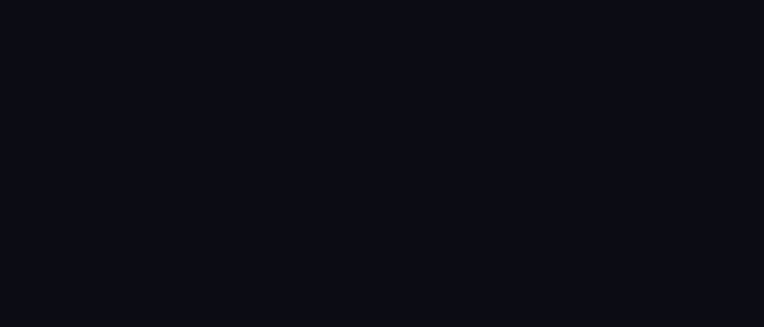

<div dir="rtl">

# ✨ Glowing Icons — ستيكرات نيون متحركة للمونتاج

مكتبة ستيكرات بتأثير نيون متوهج، **متحركة وبخلفية شفافة**، مع أداة تركّبها على أي فيديو بأمر واحد.



## كيف تتحرك؟

كل ستيكر يمر بثلاث مراحل:
1. **رسم تدريجي**: يُرسم الخط وكأن قلماً مضيئاً يرسمه، مع شرارة عند رأس القلم.
2. **نبض توهج**: يتنفس الضوء بهدوء مع ارتعاش نيون خفيف كاللافتات الحقيقية.
3. **اختفاء ناعم** في آخر لحظة.

## الستيكرات المتوفرة (21)

| الاسم | الوصف | الاسم | الوصف |
|---|---|---|---|
| `arrow` | سهم منحني | `bell` | جرس التنبيهات |
| `arrow-straight` | سهم مستقيم | `play` | زر تشغيل |
| `circle` | دائرة تأشير | `crown` | تاج |
| `underline` | خط تحت | `sparkle` | لمعة |
| `star` | نجمة | `bubble` | فقاعة كلام |
| `heart` | قلب | `fire` | نار |
| `lightning` | برق | `focus` | إطار تركيز |
| `check` | صح | `magnifier` | عدسة تكبير |
| `cross` | خطأ | `burst` | انفجار ضوئي |
| `question` | علامة سؤال | `like` | لايك |
| `exclamation` | علامة تعجب | | |

**الألوان:** `cyan` `pink` `yellow` `green` `purple` `orange` `red` `blue` `gold` `white` أو أي كود مثل `#FF00AA`.

## الملفات الجاهزة

- `assets/webm/` فيديو شفاف لكل ستيكر (512×512، 3 ثواني). يعمل في معظم برامج المونتاج ومتصفحات الويب.
- `assets/png/` صورة ثابتة شفافة لكل ستيكر.

## الاستخدام مع Claude

ارفع الفيديو في المحادثة واكتب طلبك بكلامك العادي، مثلاً:

> حط سهم متوهج فوق يمين من الثانية 5 لمدة 3 ثواني، ودائرة وردية حول الوسط في الثانية 10.

Claude يستخدم أداة `overlay.py` في هذا المستودع ويرجع لك الفيديو جاهزاً.

## الاستخدام اليدوي

```bash
pip install numpy pillow scipy   # ويلزم وجود ffmpeg

# عرض كل الستيكرات والألوان
python3 overlay.py --list

# ستيكر واحد
python3 overlay.py video.mp4 out.mp4 --add "arrow,t=5,d=3,pos=top-right"

# عدة ستيكرات
python3 overlay.py video.mp4 out.mp4 \
  --add "circle,t=2,d=2.5,pos=50%:40%,size=35%,color=pink" \
  --add "like,t=8,pos=bottom-right,size=220" \
  --add "arrow,t=10,rot=90,flip"
```

| الخيار | المعنى | الافتراضي |
|---|---|---|
| `t=` | وقت الظهور بالثواني | `0` |
| `d=` | المدة بالثواني | `3` |
| `pos=` | المكان: `center` `top-right` `bottom-left`… أو `X:Y` بالبكسل أو `50%:40%` (مركز الستيكر) | `center` |
| `size=` | الحجم بالبكسل أو نسبة من ارتفاع الفيديو | `35%` |
| `color=` | اللون | لون الستيكر |
| `rot=` | دوران بالدرجات | `0` |
| `flip` | عكس أفقي | — |
| `width=` | سماكة الخط | `1` |
| `draw=` | مدة حركة الرسم (`0` = يظهر مباشرة) | `0.7` |

## إعادة توليد الملفات

```bash
python3 export_all.py            # كل الستيكرات
python3 export_all.py heart fire # ستيكرات محددة
```

## 🎬 عدّة المونتاج الكاملة

في مجلد [`montage-kit`](montage-kit/) ستجد حركات وانتقالات ومؤثرات صوتية وفلاتر ألوان وطبقات ضوئية، كلها بدون حقوق، مع أداة تطبقها على الفيديو.

## إضافة ستيكر جديد

كل ستيكر دالة في `neon/shapes.py` ترجع قائمة خطوط بإحداثيات من ‎-1 إلى 1،
ثم يُسجَّل في قاموس `STICKERS` باسم ولون افتراضي ووصف.

</div>
