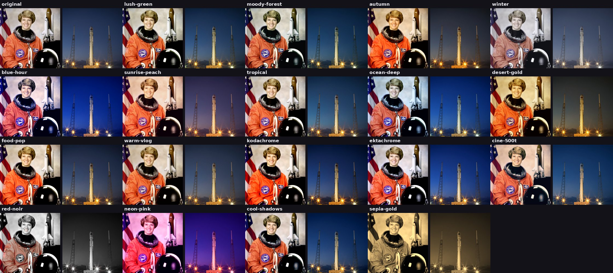
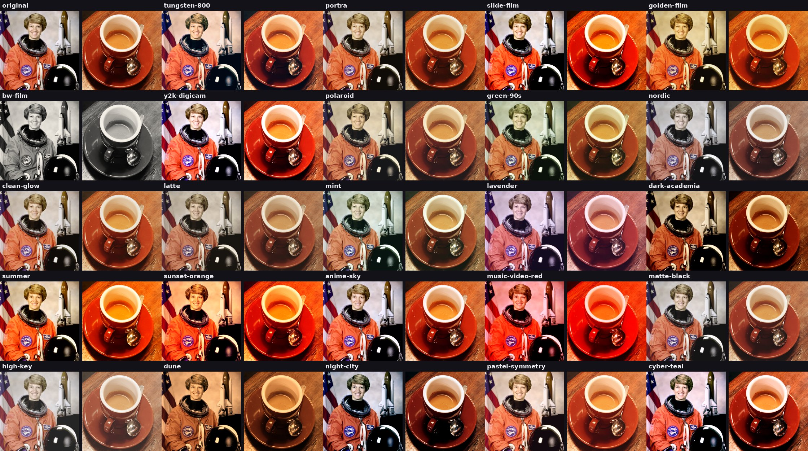
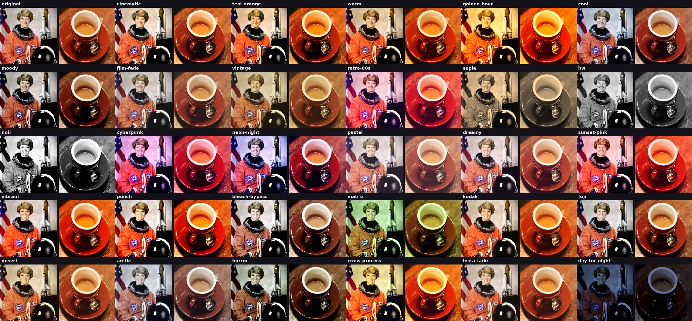
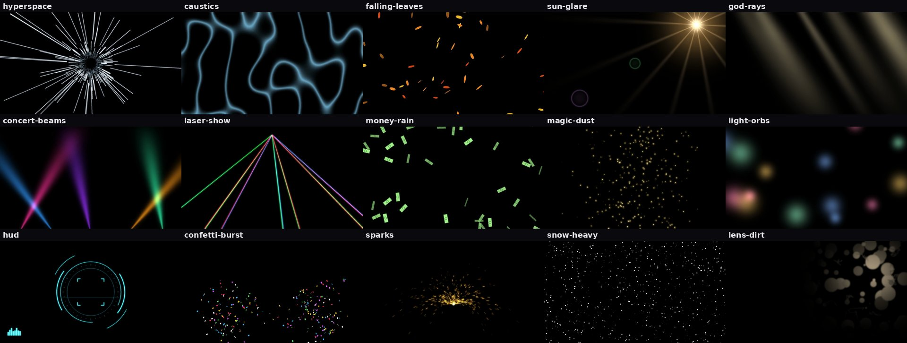
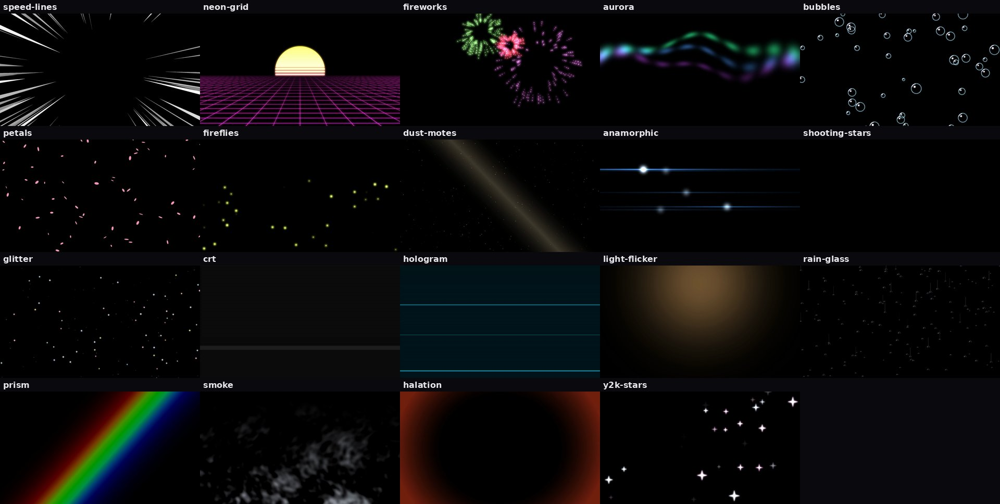
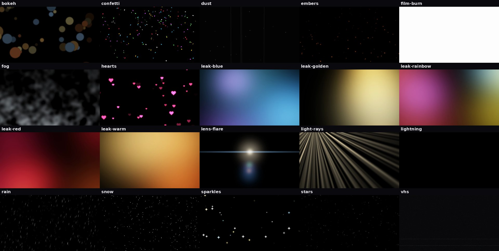

<div dir="rtl">

# 🎬 Montage Kit — عدّة المونتاج الكاملة

كل ما يحتاجه المونتير في مجلد واحد: **99 حركة ومؤثر** · **102 انتقال** · **167 مؤثر صوتي** · **71 فلتر ألوان** · **54 طبقة ضوئية**، بالإضافة لستيكرات النيون من المجلد الرئيسي.

كل شيء هنا مصنوع بالكود من الصفر، **بدون أي حقوق ملكية**، فتقدر تستخدمه في يوتيوب وتيك توك وإنستغرام والإعلانات التجارية بحرية.

## 🔥 جديد: الدفعة 3

116 إضافة جديدة (معلّمة بـ 🔥 في الجداول):

- **26 حركة ومؤثر:** سلِت سكان، أثر ألوان خلف الحركة، تعريض طويل، إبقاء لون واحد (Color Pop)، ديوتون، بوب آرت، فرز بكسلات، ASCII، رسم بالرصاص، ألوان مائية، عين السمكة، عدسة مكبرة، Vertigo، إطار داخل إطار، تلفزيون يشتغل/ينطفئ، رمشة عين، شريط فيلم، إطار جوال، ظهور كالحبر، ومضات وتوهج على الإيقاع
- **18 انتقال:** حبر، حرق بنار، تلفزيون، ستائر، مربعات تنقلب، دوامة، مسح ألوان، سلِت سكان، شرائح غلتش، فقاعات، باب ينفتح، انشقاق قطري، نفق، لطخة سرعة، مشكال، وهج عدسة، فرز بكسلات، قزحية
- **39 مؤثر صوتي:** طبول للمونتاج على الإيقاع (كيك، سنير، تصفيقة، هاي هات)، أجواء طبيعة (عصافير، أمواج، جدول، نار مخيم، ليل، رعد، ريح)، ميمز (بوق احتفال، صفرة إعجاب، دن دن)، وأصوات واقعية (صفحة، قلم، سحّاب، عملات)
- **18 فلتر ألوان:** طبيعة خضراء، غابة ضبابية، خريف، شتاء، الساعة الزرقاء، شروق، استوائي، بحر، صحراء، طعام، فلوق، كوداكروم، إكتاكروم، فيلم 500T، أبيض وأسود مع الأحمر
- **15 طبقة ضوئية:** قفزة فضائية، انعكاسات ماء، أوراق خريف، وهج شمس، أشعة بين الأشجار، أضواء مسرح، ليزر، مطر فلوس، غبار سحري، كرات ضوء، واجهة HUD، انفجار قصاصات، شرر، ثلج كثيف، أوساخ عدسة

https://github.com/barhoom98/glowing-icons/raw/main/montage-kit/previews/demo-batch3.mp4

## ⭐ جديد 2026 (الدفعة 2)

151 إضافة بطابع ترندات المونتاج الحالية (معلّمة بـ ⭐ في الجداول):

- **حركات الزمن:** ترجيع، بومرانغ، Velocity (بطيء-سريع-بطيء)، Speed Ramp، تكرار سريع، فريمات أنمي متقطعة
- **3D وتقسيم الشاشة:** ميلان ثلاثي الأبعاد، قلب بطاقة، الفيديو داخل بطاقة، لقطة بولارويد، شبكة، مرآة رباعية، كاليدوسكوب
- **ستايلات:** حواف نيون متوهجة، كوميكس، كرتون، كاميرا حرارية، رؤية ليلية، أشعة X، داتاموش، حالم
- **28 انتقال جديد بين المقاطع:** زوم عبور، تحطّم زجاج، قلب، نجمة، مكعب 3D، سحبة سريعة، تبديل بطاقات…
- **49 مؤثر صوتي:** 808، ووش سينمائي، بوابة، لمعة أنمي، بونك، صراصير الصمت المحرج، تكسير زجاج…
- **24 فلتر ألوان:** تنغستن 800، بورترا، Y2K ديجيتال، لاتيه، سماء أنمي، صحراء ملحمية…
- **19 طبقة ضوئية:** خطوط سرعة أنمي، شبكة نيون ريترو، ألعاب نارية، شفق قطبي، بتلات، خطوط أنامورفيك…

https://github.com/barhoom98/glowing-icons/raw/main/montage-kit/previews/demo-2026.mp4

## الطريقة الأسهل: اطلب من Claude

ارفع الفيديو في المحادثة واكتب ما تريده بكلامك، مثلاً:

> اعمل بومرانغ على الثانية 4 مع صوت سووش أنمي، وحواف نيون من الثانية 8، وفلتر تنغستن.

> ادمج هالمقاطع بانتقال زوم عبور وتحطّم زجاج مع صوت ووش باص.

## محتويات المجلد

| المجلد | المحتوى | الاستخدام في برامج المونتاج |
|---|---|---|
| `sfx/` | مؤثرات صوتية WAV | اسحبها مباشرة لأي برنامج |
| `luts/` | فلاتر ألوان `.cube` | CapCut: Adjust → LUT · Premiere: Lumetri → Creative → Look · DaVinci: LUTs |
| `overlays/` | طبقات ضوئية MP4 على خلفية سوداء | ضعها فوق الفيديو واختر وضع الدمج **Screen** |
| `previews/` | صور معاينة وفيديوهات تجريبية | — |
| `kit/` | الكود الذي يولّد كل شيء | — |
| `edit.py` | أداة تطبيق كل شيء على الفيديو | — |

## 🎥 الحركات والمؤثرات (`--fx`)

كل مؤثر يأخذ `t=` (وقت البداية) و `d=` (المدة) وخياراته الخاصة. المؤثرات التي تتبع نقطة تقبل أيضاً `x=` و `y=` (من 0 إلى 1).

> 🔥 مؤثرات مثل `slit-scan` و `rgb-trail` و `light-trails` تعتمد على الحركة في الفيديو، فتظهر أوضح على اللقطات المتحركة.
>
> **مؤثرات الزمن** (`velocity` · `speed-ramp` · `slow-in` · `rewind` · `boomerang` · `repeat`) تعيد ترتيب إطارات الفترة نفسها، والصوت الأصلي يكمل بشكل طبيعي.

| الاسم | النوع | الوصف | الخيارات الافتراضية |
|---|---|---|---|
| `zoom-punch` | حركة | زوم سريع على لحظة مهمة | `amount=1.25`, `speed=0.12`, `back=1`, `d=1.0` |
| `zoom-in` | حركة | زوم داخل بطيء | `amount=1.3`, `d=3.0` |
| `zoom-out` | حركة | زوم خارج بطيء | `amount=1.3`, `d=3.0` |
| `ken-burns` | حركة | زوم مع تحريك (للصور) | `amount=1.2`, `pan=1.0`, `d=5.0` |
| `shake` | حركة | اهتزاز الكاميرا | `amount=1.0`, `rotate=1.0`, `seed=1`, `d=0.8` |
| `earthquake` | حركة | اهتزاز قوي (زلزال) | `amount=1.0`, `rotate=1.0`, `seed=2`, `d=1.0` |
| `handheld` | حركة | كاميرا محمولة باليد | `amount=1.0`, `rotate=1.0`, `seed=3`, `d=5.0` |
| `pulse` | حركة | نبض مع الإيقاع | `amount=1.06`, `bpm=120`, `d=4.0` |
| `bounce` | حركة | ارتداد | `amount=1.12`, `d=1.0` |
| `tilt` | حركة | ميلان الكاميرا | `angle=8.0`, `back=1`, `d=2.0` |
| `slide-in` | حركة | دخول من جانب | `speed=0.35`, `from=left`, `d=0.5` |
| `spin` | انتقال | لفّة كاملة (تخفي القطع) | `turns=1.0`, `dir=1`, `d=0.6` |
| `whip` | انتقال | سحبة سريعة (Whip Pan) | `amount=1.0`, `dir=1`, `vertical=0`, `d=0.35` |
| `zoom-transition` | انتقال | زوم عبور بين لقطتين | `amount=2.5`, `d=0.5` |
| `flash` | انتقال | فلاش | `color=white`, `amount=1.0`, `d=0.4` |
| `dip` | انتقال | غمق ورجوع | `color=black`, `d=0.6` |
| `fade-in` | انتقال | ظهور تدريجي | `color=black`, `d=1.0` |
| `fade-out` | انتقال | اختفاء تدريجي | `color=black`, `d=1.0` |
| `impact` | ضربة | زوم+اهتزاز+فلاش للحظة قوية | `amount=1.3`, `rotate=1.0`, `seed=5`, `d=0.5` |
| `glitch` | رقمي | غلتش | `amount=1.0`, `seed=0`, `d=0.5` |
| `rgb-split` | رقمي | انفصال ألوان | `amount=1.0`, `d=1.0` |
| `vhs` | رقمي | شريط VHS قديم | `amount=1.0`, `d=3.0` |
| `strobe` | ضوء | ستروب | `rate=8.0`, `color=black`, `amount=0.8`, `d=1.0` |
| `light-sweep` | ضوء | لمعة تعبر الشاشة | `color=white`, `amount=0.5`, `d=0.8` |
| `glow` | ضوء | توهج للمناطق المضيئة | `amount=0.8`, `threshold=0.6`, `d=2.0` |
| `vignette` | ضوء | تعتيم الأطراف | `amount=0.6`, `d=3.0` |
| `bw` | لون | أبيض وأسود مؤقت | `d=2.0` |
| `invert` | لون | عكس الألوان | `d=0.1` |
| `tint` | لون | صبغة لونية | `color=cyan`, `amount=0.6`, `d=2.0` |
| `film` | لون | فيلم قديم (اهتزاز وارتعاش) | `amount=1.0`, `d=3.0` |
| `blur` | تمويه | تمويه | `amount=1.0`, `d=2.0` |
| `blur-in` | تمويه | من ضبابي لواضح | `amount=1.0`, `d=0.8` |
| `blur-out` | تمويه | من واضح لضبابي | `amount=1.0`, `d=0.8` |
| `zoom-blur` | تمويه | تمويه زوم | `amount=1.0`, `d=0.5` |
| `pixelate` | تمويه | تقطيع بكسل (إخفاء) | `w=1.0`, `h=1.0`, `block=3.0`, `d=2.0` |
| `blur-region` | تمويه | تمويه منطقة (إخفاء وجه/رقم) | `w=0.3`, `h=0.4`, `amount=1.0`, `d=2.0` |
| `mirror` | تشويه | مرآة | `d=2.0` |
| `wave` | تشويه | تموج (حلم/دوخة) | `amount=1.0`, `d=2.0` |
| `bulge` | تشويه | انتفاخ عدسة | `amount=1.0`, `d=1.5` |
| `echo` | تشويه | صدى حركة (أثر) | `amount=0.7`, `frames=8`, `d=2.0` |
| `letterbox` | سينمائي | أشرطة سينمائية متحركة | `ratio=2.35`, `back=1`, `d=4.0` |
| `freeze` | سينمائي | تجميد اللقطة | `bw=0`, `zoom=1.0`, `d=1.5` |
| `velocity` ⭐ | زمن | بطيء-سريع-بطيء (Velocity) ترند تيك توك | `amount=1.0`, `d=1.5` |
| `speed-ramp` ⭐ | زمن | سريع ثم بطيء للحظة المهمة | `amount=1.5`, `d=1.5` |
| `slow-in` ⭐ | زمن | بطيء ثم يسرع | `amount=1.5`, `d=1.5` |
| `rewind` ⭐ | زمن | ترجيع للخلف | `look=1`, `d=1.5` |
| `boomerang` ⭐ | زمن | بومرانغ (ذهاب وعودة) | `d=1.5` |
| `repeat` ⭐ | زمن | تكرار سريع (Stutter Edit) | `times=3`, `d=1.2` |
| `stutter` ⭐ | زمن | فريمات متقطعة بطابع الأنمي | `hold=3`, `d=2.0` |
| `perspective-tilt` ⭐ | 3D | ميلان ثلاثي الأبعاد | `angle=14.0`, `speed=2.0`, `d=3.0` |
| `flip-3d` ⭐ | 3D | قلب البطاقة 3D | `dir=1`, `vertical=0`, `d=0.8` |
| `frame-in` ⭐ | 3D | الفيديو داخل بطاقة فوق خلفية ضبابية | `scale=0.78`, `angle=0.0`, `d=3.0` |
| `photo-snap` ⭐ | 3D | لقطة كاميرا بولارويد | `scale=0.72`, `angle=-5.0`, `d=1.5` |
| `grid` ⭐ | تقسيم | شبكة مكررة | `n=3`, `d=0.6` |
| `split-3` ⭐ | تقسيم | ثلاث نسخ جنب بعض | `d=1.5` |
| `mirror-quad` ⭐ | تقسيم | مرآة رباعية | `d=1.5` |
| `kaleidoscope` ⭐ | تقسيم | مشكال (كاليدوسكوب) | `segments=6`, `spin=0.6`, `d=2.0` |
| `chroma-zoom` ⭐ | إيقاع | زوم وانفصال ألوان مع الإيقاع | `amount=1.08`, `bpm=120`, `d=4.0` |
| `jello` ⭐ | تشويه | اهتزاز جيلي | `amount=1.0`, `d=1.0` |
| `ripple` ⭐ | تشويه | موجة ماء من نقطة | `amount=1.0`, `d=1.2` |
| `swirl` ⭐ | تشويه | دوامة | `amount=1.0`, `d=0.8` |
| `datamosh` ⭐ | تشويه | داتاموش (تلطيخ الحركة) | `amount=1.0`, `d=1.5` |
| `neon-edges` ⭐ | ستايل | حواف نيون متوهجة | `color=rainbow`, `dark=0.7`, `d=2.0` |
| `halftone` ⭐ | ستايل | نقاط كوميكس | `size=1.0`, `color=0`, `d=2.0` |
| `cartoon` ⭐ | ستايل | رسوم كرتونية | `levels=6`, `d=2.0` |
| `thermal` ⭐ | ستايل | كاميرا حرارية | `style=1`, `d=2.0` |
| `night-vision` ⭐ | ستايل | رؤية ليلية | `d=2.0` |
| `x-ray` ⭐ | ستايل | أشعة X | `d=1.0` |
| `anaglyph` ⭐ | ستايل | ثلاثي أبعاد أحمر/أزرق | `amount=1.0`, `d=2.0` |
| `dreamy` ⭐ | ستايل | حالم متوهج | `amount=0.9`, `d=3.0` |
| `spotlight` ⭐ | تركيز | إضاءة على عنصر وتعتيم الباقي | `r=0.18`, `amount=0.75`, `d=2.0` |
| `tilt-shift` ⭐ | تركيز | مجسمات صغيرة (Miniature) | `d=3.0` |
| `focus-pull` ⭐ | تركيز | سحب التركيز | `mode=1`, `amount=1.0`, `d=1.2` |
| `rgb-trail` 🔥 | زمن | أثر ألوان خلف الحركة | `lag=4`, `d=2.0` |
| `light-trails` 🔥 | زمن | تعريض طويل (أثر الأضواء) | `decay=0.92`, `d=2.0` |
| `slit-scan` 🔥 | زمن | سلِت سكان: كل سطر من لحظة مختلفة | `frames=20`, `dir=1`, `d=2.0` |
| `color-pop` 🔥 | لون | إبقاء لون واحد والباقي أبيض وأسود | `color=red`, `width=12`, `d=3.0` |
| `duotone` 🔥 | لون | لونان فقط (ستايل بوسترات) | `dark=#1a0b3d`, `light=#ff8a3d`, `d=2.0` |
| `hue-cycle` 🔥 | لون | دوران ألوان قوس قزح | `speed=0.5`, `d=2.0` |
| `pop-art` 🔥 | ستايل | بوب آرت | `d=1.5` |
| `pixel-sort` 🔥 | ستايل | فرز بكسلات (غلتش فني) | `threshold=0.45`, `d=1.0` |
| `ascii` 🔥 | ستايل | حروف ASCII | `size=1.2`, `color=green`, `d=1.5` |
| `sketch` 🔥 | ستايل | رسم بالرصاص | `color=0`, `d=2.0` |
| `watercolor` 🔥 | ستايل | ألوان مائية | `d=2.0` |
| `emboss` 🔥 | ستايل | نقش بارز | `d=1.0` |
| `fisheye` 🔥 | عدسة | عين السمكة | `amount=1.0`, `d=2.0` |
| `magnify` 🔥 | عدسة | عدسة مكبرة على نقطة | `r=0.14`, `zoom=2.0`, `d=2.0` |
| `vertigo` 🔥 | عدسة | دولي زوم (Vertigo) | `amount=1.0`, `d=1.5` |
| `dizzy` 🔥 | عدسة | دوخة ورؤية مزدوجة | `amount=1.0`, `d=2.0` |
| `droste` 🔥 | عدسة | إطار داخل إطار لانهائي | `scale=0.72`, `depth=5`, `spin=0.0`, `d=2.0` |
| `tv-off` 🔥 | شاشة | إطفاء تلفزيون قديم | `d=0.6` |
| `tv-on` 🔥 | شاشة | تشغيل تلفزيون قديم | `d=0.6` |
| `blink` 🔥 | شاشة | رمشة عين | `d=0.5` |
| `film-strip` 🔥 | شاشة | الفيديو داخل شريط فيلم | `angle=-6.0`, `d=3.0` |
| `phone-frame` 🔥 | شاشة | الفيديو داخل إطار جوال | `angle=0.0`, `d=3.0` |
| `ink-reveal` 🔥 | شاشة | ظهور كالحبر | `seed=1`, `color=black`, `d=1.2` |
| `beat-flash` 🔥 | إيقاع | ومضة مع كل ضربة | `bpm=120`, `color=white`, `amount=0.5`, `d=4.0` |
| `glow-pulse` 🔥 | إيقاع | توهج ينبض مع الإيقاع | `bpm=120`, `amount=1.0`, `d=4.0` |
| `shake-rgb` 🔥 | إيقاع | اهتزاز مع انفصال ألوان | `amount=1.0`, `d=0.6` |

## 🔀 الانتقالات بين المقاطع (`join`)

### انتقالات مخصصة (⭐ و 🔥)

| الاسم | الوصف |
|---|---|
| `zoom-blur` ⭐ | زوم عبور مع تمويه (الأشهر) |
| `zoom-out` ⭐ | زوم للخارج |
| `spin` ⭐ | لفّة مع تمويه |
| `whip-left` ⭐ | سحبة سريعة لليسار |
| `whip-right` ⭐ | سحبة سريعة لليمين |
| `whip-up` ⭐ | سحبة سريعة للأعلى |
| `whip-down` ⭐ | سحبة سريعة للأسفل |
| `glitch` ⭐ | غلتش |
| `rgb-split` ⭐ | انفصال ألوان |
| `flash-burn` ⭐ | فلاش دافئ |
| `light-leak` ⭐ | تسريب ضوء |
| `circle` ⭐ | دائرة تكشف |
| `heart` ⭐ | قلب يكشف |
| `star` ⭐ | نجمة تكشف |
| `diamond` ⭐ | معيّن يكشف |
| `split-panels` ⭐ | شرائح تدخل متتابعة |
| `stretch` ⭐ | مطّ |
| `ripple` ⭐ | تموّج ماء |
| `cube` ⭐ | مكعب 3D |
| `flip` ⭐ | قلب بطاقة 3D |
| `push` ⭐ | دفع مع ظل |
| `pixel` ⭐ | بكسلة |
| `shake-cut` ⭐ | اهتزاز وقطع |
| `blur-dissolve` ⭐ | ذوبان مع تمويه |
| `luma` ⭐ | ظهور حسب الإضاءة |
| `shatter` ⭐ | تحطّم زجاج |
| `card-swap` ⭐ | تبديل بطاقات |
| `bounce-slide` ⭐ | انزلاق مع ارتداد |
| `ink` 🔥 | حبر ينتشر |
| `burn` 🔥 | حرق بحافة نار |
| `tv-switch` 🔥 | تبديل تلفزيون قديم |
| `blinds` 🔥 | ستائر تدور |
| `mosaic-flip` 🔥 | مربعات تنقلب |
| `swirl` 🔥 | دوامة |
| `rgb-wipe` 🔥 | مسح بالألوان الثلاثة |
| `slit-scan` 🔥 | سلِت سكان |
| `glitch-slice` 🔥 | شرائح غلتش |
| `bubbles` 🔥 | فقاعات تكشف |
| `doors` 🔥 | باب ينفتح |
| `diagonal` 🔥 | انشقاق قطري |
| `warp-tunnel` 🔥 | نفق |
| `smear` 🔥 | لطخة سرعة |
| `kaleido` 🔥 | مشكال |
| `flare-cut` 🔥 | وهج عدسة يخفي القطع |
| `pixel-sort` 🔥 | فرز بكسلات |
| `iris` 🔥 | قزحية (ستايل الأفلام القديمة) |

`--transition random` يختار انتقالاً مختلفاً من هذه القائمة لكل قطع.

### انتقالات كلاسيكية

`fade` · `fadeblack` · `fadewhite` · `dissolve` · `wipeleft` · `wiperight` · `wipeup` · `wipedown` · `slideleft` · `slideright` · `slideup` · `slidedown` · `smoothleft` · `smoothright` · `smoothup` · `smoothdown` · `circleopen` · `circleclose` · `circlecrop` · `rectcrop` · `vertopen` · `vertclose` · `horzopen` · `horzclose` · `radial` · `pixelize` · `zoomin` · `hblur` · `fadegrays` · `distance` · `diagtl` · `diagtr` · `diagbl` · `diagbr` · `hlslice` · `hrslice` · `vuslice` · `vdslice` · `squeezeh` · `squeezev` · `wipetl` · `wipetr` · `wipebl` · `wipebr` · `hlwind` · `hrwind` · `vuwind` · `vdwind` · `coverleft` · `coverright` · `coverup` · `coverdown` · `revealleft` · `revealright` · `revealup` · `revealdown`

**اختصارات:** `flash`→`fadewhite` · `black`→`fadeblack` · `white`→`fadewhite` · `zoom`→`zoomin` · `blur`→`hblur` · `slide`→`slideleft` · `wipe`→`wipeleft` · `cross`→`dissolve` · `gray`→`fadegrays` · `wind`→`hlwind`

> كل الانتقالات المخصصة (⭐ و🔥) تُخلط مع بعضها، ومع `fade` و `fadeblack` و `fadewhite` و `slideleft/right/up/down` في نفس الأمر.
> للانتقال داخل فيديو واحد عند نقطة قطع، استخدم مؤثرات: `zoom-transition` · `whip` · `spin` · `flash` · `glitch` · `flip-3d`

## 🔊 المؤثرات الصوتية (`--sfx`)

**انتقالات:** `whoosh-short` ووش قصير · `whoosh-long` ووش طويل · `whoosh-deep` ووش عميق بباص · `whoosh-double` ووش مزدوج · `whoosh-reverse` ووش يتصاعد وينقطع · `swoosh-fast` سووش سريع · `swish-air` هواء خفيف · `whip` ضربة سوط سريعة · `zoom-in` صوت زوم داخل · `zoom-out` صوت زوم خارج · `swipe` سحب سريع · `whoosh-cinematic` ⭐ ووش سينمائي مع ضربة · `bass-whoosh` ⭐ ووش باص · `glitch-whoosh` ⭐ ووش مع غلتش · `swoosh-up` ⭐ سووش صاعد · `swoosh-down` ⭐ سووش نازل · `tape-whoosh` ⭐ ووش شريط متموج · `uplifter` 🔥 رايزر هوائي · `sub-whoosh` 🔥 ووش باص عميق · `digital-transition` 🔥 انتقال رقمي · `glitch-stutter` 🔥 تقطيع غلتش · `vinyl-scratch-short` 🔥 سكراتش قصير

**ضربات:** `impact-boom` بوم سينمائي · `cinematic-hit` ضربة سينمائية معدنية · `bass-drop` باص دروب · `sub-drop` هبوط باص عميق · `thud` ضربة مكتومة · `punch` لكمة · `slam` ضربة قوية · `braam` برااام سينمائي (ترايلر) · `vine-boom` بوم الميمز · `metal-hit` ⭐ ضربة معدن · `hit-reverb` ⭐ ضربة بصدى · `trap-808` ⭐ باص 808 · `slap` ⭐ صفعة · `heartbeat-boom` ⭐ نبضتين ثم بوم · `glass-break` ⭐ تكسير زجاج · `ice-crack` ⭐ تشقق جليد · `lightning-crack` ⭐ رعد

**تصاعد:** `riser-tension` تصاعد توتر 3 ثواني · `riser-short` تصاعد قصير · `downlifter` هبوط تدريجي · `reverse-cymbal` صنج معكوس · `crash` صنج كراش · `drum-roll` قرع طبول مع ضربة · `riser-hit` ⭐ تصاعد ينتهي بضربة · `reverse-hit` ⭐ ضربة معكوسة · `cinematic-rise` ⭐ تصاعد سينمائي بنبض

**واجهات:** `pop` بوب · `bubble-pop` فقاعة · `click` نقرة · `mouse-click` كبسة ماوس · `tick` تك · `toggle` مفتاح تشغيل · `notification` تنبيه · `message` رسالة واصلة · `success` نجاح · `error` خطأ · `coin` عملة (ألعاب) · `level-up` ليفل أب (ألعاب) · `correct` إجابة صحيحة · `wrong-buzzer` إجابة خاطئة · `pop-modern` ⭐ بوب حديث · `ui-hover` ⭐ مرور على زر · `ui-confirm` ⭐ تأكيد · `pluck-notify` ⭐ تنبيه نقر وتر · `subscribe-ding` ⭐ جرس اشتراك · `ding-dong` ⭐ جرس باب · `phone-vibrate` ⭐ اهتزاز جوال · `camera-focus` ⭐ تركيز كاميرا · `shutter-burst` ⭐ تصوير متتابع · `typing-soft` ⭐ كتابة ناعمة · `clock-alarm` ⭐ منبه · `magic-wand` 🔥 عصا سحرية · `level-complete` 🔥 إنهاء مرحلة · `notification-soft` 🔥 تنبيه ناعم · `enter-key` 🔥 زر Enter · `mouse-scroll` 🔥 تمرير الماوس · `timer-end` 🔥 انتهاء المؤقت · `heartbeat-fast` 🔥 نبض سريع (توتر)

**رقمي:** `glitch-1` غلتش · `glitch-2` غلتش طويل · `glitch-short` غلتش قصير · `static` تشويش · `data-beeps` بيانات تقنية · `bleep` صفير حجب الكلام · `countdown` عد تنازلي 3-2-1 · `laser` ليزر · `power-up` تشغيل · `power-down` إطفاء · `camera-flash` فلاش كاميرا

**كرتون:** `boing` بوينغ · `slide-up` صفارة صاعدة · `slide-down` صفارة نازلة · `cartoon-pop` فلينة · `spring` زنبرك · `sad-trombone` ترومبون حزين (فشل) · `meme-bruh` نغمة ميمز هابطة · `ta-da` تا-دا

**واقعية:** `camera-shutter` غالق كاميرا · `typing` كتابة على كيبورد · `typewriter-ding` جرس آلة كاتبة · `heartbeat` نبض قلب · `clock-tick` تكتكة ساعة · `cash-register` كاشير (كا-تشينغ) · `record-scratch` خدش أسطوانة · `tape-stop` توقف شريط · `rewind` ترجيع · `vinyl-crackle` طقطقة أسطوانة قديمة · `footsteps` خطوات · `door-knock` طرق باب · `balloon-pop` ⭐ انفجار بالون · `water-drop` ⭐ قطرة ماء · `splash` ⭐ رشة ماء · `fire-whoosh` ⭐ اشتعال نار · `camera-zoom-whir` 🔥 محرك زوم كاميرا · `page-turn` 🔥 قلب صفحة · `pen-scribble` 🔥 شخبطة قلم · `zipper` 🔥 سحّاب · `door-slam` 🔥 إغلاق باب بقوة · `coins` 🔥 عملات معدنية

**موسيقية:** `magic-shimmer` لمعة سحرية · `harp-gliss` هارب صاعد (حلم/ذكرى) · `dramatic-sting` دن دن دااان · `suspense-hit` ضربة غموض · `suspense-drone` خلفية توتر · `deep-drone` ⭐ خلفية عميقة · `lofi-vinyl-stop` ⭐ توقف لوفاي

**أجواء:** `wind` رياح · `rain` مطر · `crowd-cheer` تشجيع وتصفيق

**خيال علمي:** `portal` ⭐ بوابة · `teleport` ⭐ انتقال آني · `warp` ⭐ قفزة فضائية · `sci-fi-scan` ⭐ مسح ضوئي · `robot-beeps` ⭐ روبوت · `electric-zap` ⭐ صعقة كهرباء · `radar-ping` ⭐ رادار

**ميمز:** `bonk` ⭐ بونك · `crickets` ⭐ صراصير (صمت محرج) · `magic-poof` ⭐ بوف سحري · `anime-sparkle` ⭐ لمعة أنمي · `anime-swoosh` ⭐ سووش أنمي · `jump-8bit` ⭐ قفزة 8bit · `game-over` ⭐ خسارة لعبة · `success-fanfare` ⭐ احتفال فوز · `airhorn` 🔥 بوق الاحتفال (Airhorn) · `whistle-up` 🔥 صفرة صاعدة · `wolf-whistle` 🔥 صفرة إعجاب · `dun-dun` 🔥 دن دن (درامي) · `tada-short` 🔥 تادا قصيرة · `record-rewind-long` 🔥 ترجيع طويل

**طبول:** `kick` 🔥 طبلة كيك · `snare` 🔥 سنير · `clap` 🔥 تصفيقة · `hihat` 🔥 هاي هات مغلق · `open-hat` 🔥 هاي هات مفتوح · `tom-fill` 🔥 فيل طبول نازل · `beat-4` 🔥 إيقاع جاهز ثانيتين · `cymbal-swell` 🔥 صنج يتصاعد

**طبيعة:** `forest-birds` 🔥 عصافير في غابة · `ocean-waves` 🔥 أمواج بحر · `stream` 🔥 جدول ماء · `campfire` 🔥 نار مخيم · `night-ambience` 🔥 ليل وصراصير · `thunder-roll` 🔥 رعد متدحرج · `wind-gust` 🔥 هبّة ريح

## 🎨 فلاتر الألوان (`--lut`)







| الاسم | الوصف |
|---|---|
| `cinematic` | سينمائي متوازن |
| `teal-orange` | تركواز وبرتقالي (أفلام هوليوود) |
| `warm` | دافئ |
| `golden-hour` | ساعة ذهبية |
| `cool` | بارد |
| `moody` | مزاجي داكن |
| `film-fade` | فيلم باهت |
| `vintage` | قديم (فينتج) |
| `retro-80s` | ريترو الثمانينات |
| `sepia` | بني قديم |
| `bw` | أبيض وأسود |
| `noir` | أبيض وأسود عالي التباين |
| `cyberpunk` | سايبربانك |
| `neon-night` | ليل نيون |
| `pastel` | باستيل ناعم |
| `dreamy` | حالم |
| `sunset-pink` | غروب وردي |
| `vibrant` | ألوان حيوية |
| `punch` | تباين قوي |
| `bleach-bypass` | بليتش (أفلام حرب/أكشن) |
| `matrix` | أخضر ماتريكس |
| `kodak` | فيلم كوداك |
| `fuji` | فيلم فوجي |
| `desert` | صحراوي |
| `arctic` | قطبي بارد |
| `horror` | رعب |
| `cross-process` | كروس بروسس |
| `insta-fade` | إنستغرام باهت |
| `day-for-night` | تحويل النهار لليل |
| `tungsten-800` ⭐ | فيلم ليلي تنغستن (ترند 2026) |
| `portra` ⭐ | بورتريه فيلم دافئ |
| `slide-film` ⭐ | فيلم شرائح ألوان غنية |
| `golden-film` ⭐ | فيلم ذهبي |
| `bw-film` ⭐ | أبيض وأسود فيلم |
| `y2k-digicam` ⭐ | كاميرا ديجيتال Y2K |
| `polaroid` ⭐ | بولارويد |
| `green-90s` ⭐ | تسعينات مخضر |
| `nordic` ⭐ | إسكندنافي هادئ |
| `clean-glow` ⭐ | مضيء نظيف (فلوق) |
| `latte` ⭐ | بيج لاتيه |
| `mint` ⭐ | نعناعي |
| `lavender` ⭐ | لافندر |
| `dark-academia` ⭐ | داكن أكاديمي |
| `summer` ⭐ | صيفي |
| `sunset-orange` ⭐ | غروب برتقالي |
| `anime-sky` ⭐ | سماء أنمي |
| `music-video-red` ⭐ | أحمر فيديو كليب |
| `matte-black` ⭐ | أسود مطفي |
| `high-key` ⭐ | إضاءة عالية بيضاء |
| `dune` ⭐ | صحراء ملحمية برتقالية |
| `night-city` ⭐ | مدينة ليلية |
| `pastel-symmetry` ⭐ | باستيل حالم |
| `cyber-teal` ⭐ | سايبر تركوازي |
| `lush-green` 🔥 | طبيعة خضراء غنية |
| `moody-forest` 🔥 | غابة ضبابية داكنة |
| `autumn` 🔥 | خريفي ذهبي |
| `winter` 🔥 | شتوي بارد |
| `blue-hour` 🔥 | الساعة الزرقاء |
| `sunrise-peach` 🔥 | شروق خوخي |
| `tropical` 🔥 | شاطئ استوائي |
| `ocean-deep` 🔥 | بحر عميق |
| `desert-gold` 🔥 | صحراء ذهبية |
| `food-pop` 🔥 | طعام شهي |
| `warm-vlog` 🔥 | فلوق دافئ |
| `kodachrome` 🔥 | كوداكروم كلاسيكي |
| `ektachrome` 🔥 | إكتاكروم أزرق |
| `cine-500t` 🔥 | فيلم ليلي 500T |
| `red-noir` 🔥 | أبيض وأسود مع الأحمر |
| `neon-pink` 🔥 | نيون وردي |
| `cool-shadows` 🔥 | ظلال باردة |
| `sepia-gold` 🔥 | بني ذهبي |

يمكن تخفيف قوة الفلتر: `--lut cinematic,strength=0.6`

## ✨ الطبقات الضوئية (`--overlay`)







| الاسم | الوصف |
|---|---|
| `leak-warm` | تسريب ضوء دافئ |
| `leak-golden` | تسريب ضوء ذهبي |
| `leak-red` | تسريب ضوء أحمر |
| `leak-blue` | تسريب ضوء أزرق |
| `leak-rainbow` | تسريب ضوء ملون |
| `lens-flare` | وهج عدسة يعبر الشاشة |
| `light-rays` | أشعة ضوء |
| `sparkles` | لمعات |
| `bokeh` | بوكيه (دوائر ضوء ضبابية) |
| `stars` | نجوم تتلألأ |
| `snow` | ثلج |
| `rain` | مطر |
| `embers` | جمر متطاير |
| `confetti` | قصاصات احتفال |
| `hearts` | قلوب طائرة |
| `dust` | غبار وخدوش فيلم قديم |
| `vhs` | VHS شريط فيديو قديم |
| `film-burn` | حرق فيلم (انتقال) |
| `fog` | ضباب |
| `lightning` | برق وعاصفة |
| `speed-lines` ⭐ | خطوط سرعة أنمي |
| `neon-grid` ⭐ | شبكة نيون ريترو مع شمس |
| `fireworks` ⭐ | ألعاب نارية |
| `aurora` ⭐ | شفق قطبي |
| `bubbles` ⭐ | فقاعات صابون |
| `petals` ⭐ | بتلات ورد متطايرة |
| `fireflies` ⭐ | يراعات مضيئة |
| `dust-motes` ⭐ | ذرات غبار في شعاع ضوء |
| `anamorphic` ⭐ | خطوط ضوء أنامورفيك زرقاء |
| `shooting-stars` ⭐ | شهب |
| `glitter` ⭐ | جليتر لامع |
| `crt` ⭐ | خطوط شاشة CRT |
| `hologram` ⭐ | هولوغرام |
| `light-flicker` ⭐ | وميض لمبة/شمعة |
| `rain-glass` ⭐ | قطرات على زجاج |
| `prism` ⭐ | انكسار قوس قزح |
| `smoke` ⭐ | دخان صاعد |
| `halation` ⭐ | هالة فيلم حمراء |
| `y2k-stars` ⭐ | نجوم Y2K لامعة |
| `hyperspace` 🔥 | قفزة فضائية (نجوم تتمدد) |
| `caustics` 🔥 | انعكاسات ماء (تحت الماء) |
| `falling-leaves` 🔥 | أوراق خريف تتساقط |
| `sun-glare` 🔥 | وهج شمس بحلقات عدسة |
| `god-rays` 🔥 | أشعة نازلة بين الأشجار |
| `concert-beams` 🔥 | أضواء مسرح متحركة |
| `laser-show` 🔥 | عرض ليزر |
| `money-rain` 🔥 | مطر فلوس |
| `magic-dust` 🔥 | غبار سحري حلزوني |
| `light-orbs` 🔥 | كرات ضوء ملونة |
| `hud` 🔥 | واجهة مستقبلية HUD |
| `confetti-burst` 🔥 | انفجار قصاصات احتفال |
| `sparks` 🔥 | شرر لحام |
| `snow-heavy` 🔥 | ثلج كثيف مع ريح |
| `lens-dirt` 🔥 | أوساخ عدسة مع ضوء |

خيارات: `t=` `d=` `opacity=` — تدخل وتخرج بنعومة تلقائياً.

## ⌨️ الاستخدام اليدوي

```bash
pip install -r montage-kit/requirements.txt   # ويلزم ffmpeg

# عرض كل شيء متوفر (الجديد معلّم بنجمة)
python3 montage-kit/edit.py list
python3 montage-kit/edit.py list transitions

# تطبيق مؤثرات على فيديو
python3 montage-kit/edit.py apply in.mp4 out.mp4 \
  --fx "boomerang,t=4,d=1.2" --sfx "anime-swoosh,t=4" \
  --fx "neon-edges,t=8,d=2" --sfx "electric-zap,t=8" \
  --fx "spotlight,t=12,d=2,x=0.4,y=0.35" \
  --overlay "speed-lines,t=6,d=1.5,opacity=0.6" \
  --sticker "arrow,t=10,pos=top-right" \
  --lut tungsten-800 --grain 0.3 --vignette 0.5 \
  --music song.mp3,vol=0.25,duck=1

# دمج مقاطع بانتقالات مخصصة وصوت ووش
python3 montage-kit/edit.py join a.mp4 b.mp4 c.mp4 out.mp4 \
  --transition zoom-blur --transition shatter --td 0.6 --whoosh --whoosh-sfx bass-whoosh
```

| خيار عام | المعنى |
|---|---|
| `--lut NAME,strength=` | فلتر ألوان على كامل الفيديو (أو مسار ملف .cube خاص بك) |
| `--grain 0-1` | حبيبات فيلم |
| `--vignette 0-1` | تعتيم الأطراف |
| `--sharpen 0-1` | زيادة الحدة |
| `--music FILE,vol=,duck=1,start=` | موسيقى خلفية تنخفض تلقائياً عند الكلام |
| `--voice 1.0` | مستوى صوت الفيديو الأصلي |
| `--sticker` | ستيكر نيون (نفس صيغة `overlay.py` في المجلد الرئيسي) |

| خيار للدمج `join` | المعنى |
|---|---|
| `--transition NAME` | كرّره لتحديد انتقال لكل قطع بالترتيب |
| `--td 0.5` | مدة الانتقال |
| `--whoosh` / `--whoosh-sfx` / `--whoosh-vol` | صوت مع كل انتقال |
| `--size 1080x1920` | مقاس الفيديو الناتج (مثلاً عمودي للريلز) |

## إعادة توليد الملفات

```bash
python3 montage-kit/generate.py            # الكل
python3 montage-kit/generate.py sfx boing  # عنصر محدد
```

لإضافة مؤثر جديد: أضف دالته في الملف المناسب داخل `kit/` وسجّله في القاموس أسفل الملف.

</div>
